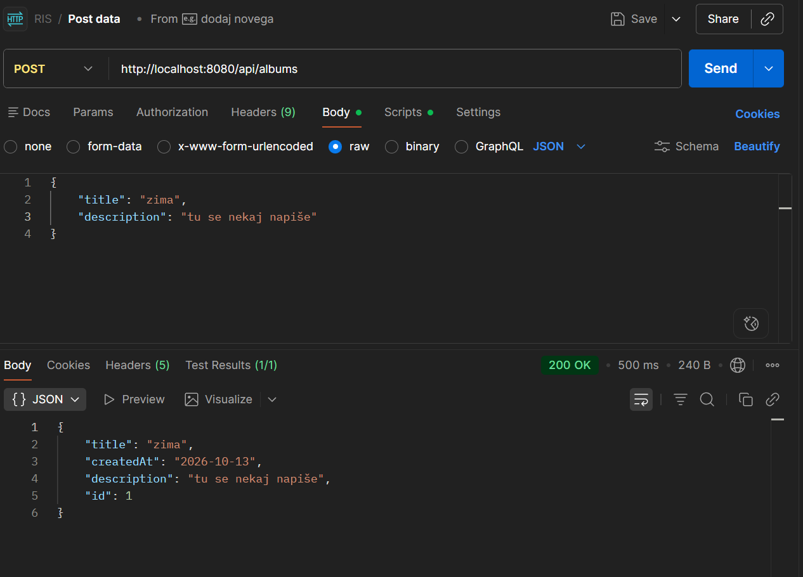
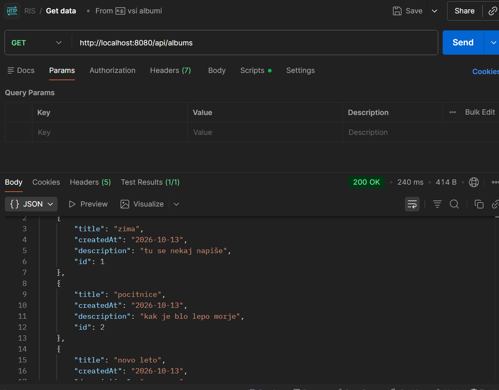
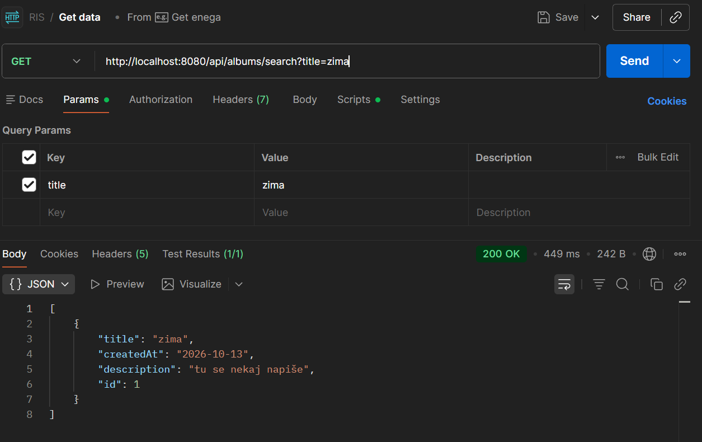
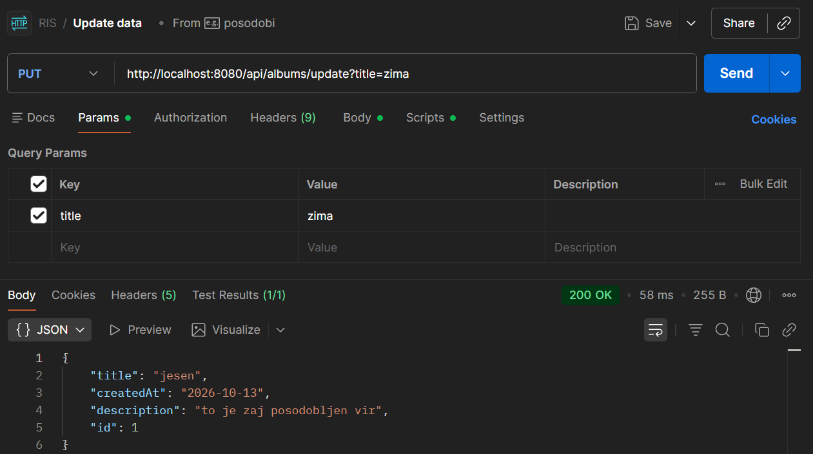
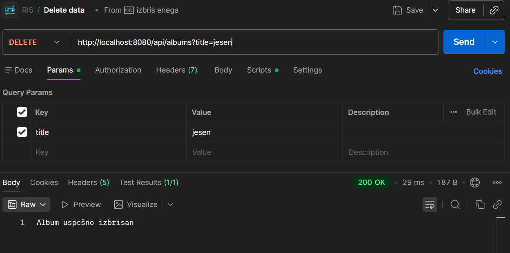
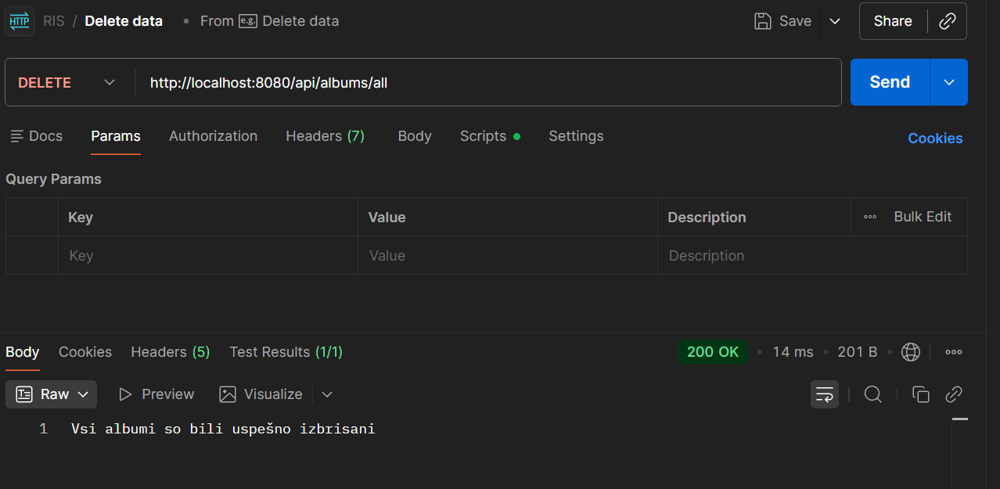

# DIGITALNI FOTO ALBUM

## Naloga 1

### POST
Najprej bomo ustvarili nove albume z zahtevo POST preko povezave: http://localhost:8080/api/albums
    V telo te zahteve moramo vpisati naslov in opis albuma, datum in id pa se generirata sama.
    ti podatki se pa natao shranijo v pomnilnik oz. H2 podatkovno bazo.

### GET
Nato smo pridobili vse albume z zahtevo GET preko povezave: http://localhost:8080/api/albums
    In dobili rezultat:

### GET
Imamo še eno zahtevo GET s katero pridobimo en album glde na naslov albuma, preko povezave: http://localhost:8080/api/albums/search?title=zima
    Z rezultatom:

### PUT
Zahteva PUT nam pa omogoča da lahko kakšen podatek spremenimo na povezavi: http://localhost:8080/api/albums/update?title=zima
    v povezavi pošljemo trenutnen naslov albuma in v telesu lahko posodobimo naslov in opis.

### DELETE
Zahteva DELETE nam omogoča izbrisati samo en album ali vse na enkrat, na povezavi: http://localhost:8080/api/albums?title=jesen
    in povezavi: http://localhost:8080/api/albums/all

